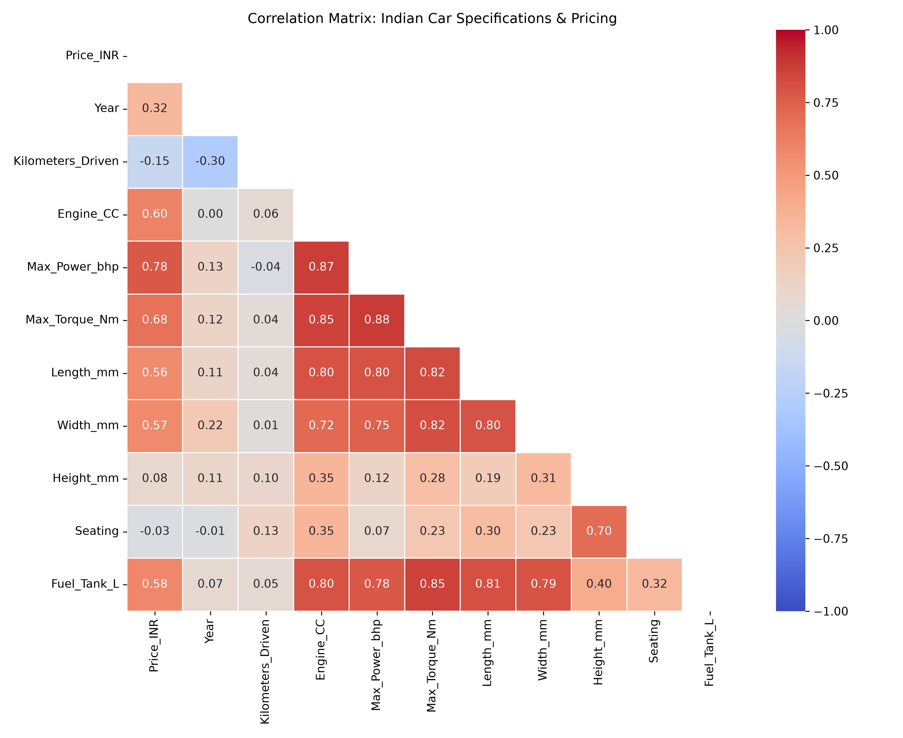

# Indian Car Specifications — Correlation Analysis

Correlation matrix and heatmap analyzing pricing, engine capacity, power, torque, and dimensions across Indian car models.

A Python data analysis project that fetches real-world Indian used-car listings, computes a Pearson correlation matrix across pricing, usage, and vehicle specifications, identifies the strongest positive and negative relationships, and visualizes them as a heatmap.

Dataset Overview
* Source: [`car details v4.csv`](https://github.com/chandanverma07/DataSets/blob/master/car%20details%20v4.csv) by [`chandanverma07`](https://github.com/chandanverma07) (originally scraped from CarDekho).
* Size & Features: ~2,059 Indian car listings covering resale price (`INR`), manufacturing year, kilometers driven, engine displacement (`cc`), max power (`bhp`), max torque (`Nm`), exterior dimensions (`mm`), seating capacity, and fuel tank capacity (`L`).

